<div align="center">



# 🎯 Bug Bounties — Vulnerability Research Portfolio

**Hallazgos reales de seguridad reportados a programas de Bugcrowd, HackerOne y VDP directos.**
Reporte responsable · CVEs · Hall of Fame · Recompensas.

[](https://github.com/kur0s4k1)
[](https://github.com/kur0s4k1)
[](https://github.com/kur0s4k1/HackTheBox-Writeups)

</div>

---

## 👤 Sobre este repositorio

Este repositorio documenta mi trabajo como **security researcher** en programas de
divulgación de vulnerabilidades. Cada entrada corresponde a un hallazgo reportado
a través de una plataforma (Bugcrowd, HackerOne) o un programa de divulgación
directa (VDP), con su empresa objetivo, programa, tipo, clase de vulnerabilidad,
prioridad, estado y —cuando aplica— la recompensa obtenida.

> ⚠️ **Divulgación responsable.** Los endpoints y detalles sensibles están
> deliberadamente **saneados** (se conserva el host y se enmascaran rutas,
> parámetros y payloads). Solo se publican detalles completos cuando el programa
> autoriza la divulgación o tras la resolución del reporte. Consulta
> [`DISCLOSURE.md`](DISCLOSURE.md).

---

## 📊 Resumen ejecutivo

| Métrica | Valor |
|:--|:--|
| Hallazgos totales | **34** |
| Aceptados / validados | **13** |
| Duplicados | 17 |
| Recompensas acumuladas | **$1,425 USD** |
| Programas (empresas) | 18 |
| Clases de vulnerabilidad | 12 |


**Top clases de vulnerabilidad**

| Vulnerabilidad | Nº |
|:--|--:|
| Broken Access Control | 6 |
| IDOR | 5 |
| PII Leakage/Exposure | 5 |
| Remote Code Execution | 4 |
| Privilege Escalation | 4 |
| Account Take Over | 3 |
| Sensitive Data Exposure | 2 |
| Subdomain Takeover | 1 |
| Blind SQL Injection | 1 |
| Privileged Workflow Execution | 1 |


---

## 📈 Desglose

**Por estado**

| Categoría | Nº | % |
|:--|--:|--:|
| Aceptado | 13 | 38% |
| En analisis | 1 | 3% |
| Duplicado | 17 | 50% |
| No Aplica | 3 | 9% |


**Por prioridad (severidad)**

| Categoría | Nº | % |
|:--|--:|--:|
| P1 | 10 | 29% |
| P2 | 15 | 44% |
| P3 | 5 | 15% |
| P4 | 1 | 3% |
| P5 | 3 | 9% |


**Por tipo de target**

| Categoría | Nº | % |
|:--|--:|--:|
| Web App | 23 | 68% |
| Source Code | 11 | 32% |


---

## 📁 Hallazgos

> Tabla resumida. La leyenda `host` indica el activo saneado. El detalle
> técnico cuando está autorizado vive en [`Findings/`](Findings/).

| # | Hallazgo | Empresa | Programa | Tipo | Vulnerabilidad | Prioridad | Estado | Fecha | Recompensa |
|--:|:--|:--|:--|:--|:--|:--:|:--:|:--:|:--|
| 1 | Contributor-to-Admin Stored XSS via oEmbed scripts -> RCE (WordPress 7.0.4) <br>`WordPress Core` | Wordpress Core | HackerOne | Source Code | Remote Code Execution | P1 | Duplicado | 12 de agosto de 2026 | — |
| 2 | Remote Code Execution (RCE) via Command Argument Injection and Internal Supply Chain Poisoning via Shared Node Modules <br>`chatgpt.com` | OpenAI | Bugcrowd | Web App | Remote Code Execution | P1 | No Aplica | 12 de febrero de 2026 | — |
| 3 | Unauthenticated Workflow Queue Callback Enables Privileged Workflow Execution <br>`@workflow/core@4.8.3` | Vercel Open Source | HackerOne | Source Code | Privileged Workflow Execution | P1 | Duplicado | 15 de agosto de 2026 | — |
| 4 | Cross-project runner hijack via fine-grained PAT scope bypass (RunnerUpdate) <br>`gitlab.com/…` | Gitlab | HackerOne | Source Code | Boundary-bypass | P1 | Duplicado | 16 de agosto de 2026 | — |
| 5 | Public Exposure of Sensitive Employee Information <br>`nef.nasa.gov/…` | NASA | Bugcrowd | Web App | PII Leakage/Exposure | P1 | Aceptado | 18 de agosto de 2025 | 🏅 Reconocimiento |
| 6 | DOM XSS via unsafe postMessage on www.webmd.com leads to WBMD_AUTHP bearer replay and account takeover <br>`www.webmd.com/…` | INTERNET BRANDS | Bugcrowd | Web App | Account Take Over | P1 | Duplicado | 19 de julio de 2026 | — |
| 7 | Exposed Bitly Token Enables wb.md Link Takeover <br>`img.lb.wbmdstatic.com/…` | INTERNET BRANDS | Bugcrowd | Web App | Sensitive Data Exposure | P1 | Duplicado | 19 de julio de 2026 | — |
| 8 | Pre-Authentication SQL Injection in WordPress Core REST API Batch Endpoint with Potential RCE via the wp2shell chain <br>`mrc.cci.drexel.edu` | DREXEL UNIVERSITY | VDP Directo | Web App | Remote Code Execution | P1 | Aceptado | 19 de julio de 2026 | 🏅 Reconocimiento |
| 9 | Unauthenticated Stacked Blind SQL Injection <br>`events.hfc.harvard.edu/…` | HARVARD UNIVERSITY | Bugcrowd | Web App | Blind SQL Injection | P1 | En analisis | 21 de julio de 2026 | 🏅 Reconocimiento |
| 10 | Flask session forgery -> SQL Scheduler Injection -> RCE <br>`redcct.cl` | REDCCT METRO | Ninguno | Web App | Remote Code Execution | P1 | Aceptado | 23 de julio de 2026 | — |
| 11 | Unverified Teacher Self-Promotion to Verified Instructor via International Opt-In <br>`adhoc-bugcrowd-studio.cdn-code.org` | CODE.ORG | Bugcrowd | Web App | Privilege Escalation | P2 | Duplicado | 14 de junio de 2026 | — |
| 12 | Teacher Tools / IDOR in Rubric Teacher Evaluation endpoints allows not-in-section student feedback submission <br>`adhoc-bugcrowd-studio.cdn-code.org` | CODE.ORG | Bugcrowd | Web App | IDOR | P2 | Aceptado | 14 de mayo de 2026 | 💵 $1,000 |
| 13 | Karapace Primary Election Poisoning Enables Credential Theft <br>`github.com/…` | Aiven Managed Bug Bounty | Bugcrowd | Source Code | Server-Side Request Forgery (SSRF) | P2 | Duplicado | 16 de agosto de 2026 | — |
| 14 | Karapace TLS Verification Bypass Enables Admin Credential Theft and Persistent Schema Poisoning <br>`github.com/…` | Aiven Managed Bug Bounty | Bugcrowd | Source Code | Privilege Escalation | P2 | Duplicado | 16 de agosto de 2026 | — |
| 15 | Unauthenticated REST API disclosure of bbPress Hidden-forum topics and replies <br>`bbPress Core` | Wordpress Core | HackerOne | Source Code | Broken Access Control | P2 | Duplicado | 17 de agosto de 2026 | — |
| 16 | Named Collection lock bypass via addresses_expr leaks stored PostgreSQL password <br>`github.com/…` | ClickHouse | Bugcrowd | Source Code | Privilege Escalation | P2 | Duplicado | 17 de agosto de 2026 | — |
| 17 | Unauthenticated Mass PII Exfiltration via BFLA <br>`certification-learning.hpe.com/…` | HPE | HackerOne | Web App | PII Leakage/Exposure | P2 | Aceptado | 18 de mayo de 2026 | 🏅 Reconocimiento |
| 18 | Pair Programming bypass lets removed student modify classmates' work <br>`adhoc-bugcrowd-studio.cdn-code.org/…` | CODE.ORG | Bugcrowd | Web App | Privilege Escalation | P2 | Duplicado | 19 de julio de 2026 | — |
| 19 | Unauthenticated IDOR in Lead Processing API Enables Lead PII Read/Write <br>`www.carsdirect.com/…` | INTERNET BRANDS | Bugcrowd | Web App | IDOR | P2 | No Aplica | 2 de agosto de 2026 | — |
| 20 | Stored WP_Font_Face CSS Injection Enables One-Click Multisite Super Admin Takeover <br>`WordPress Core` | Wordpress Core | HackerOne | Source Code | Account Take Over | P2 | Aceptado | 20 de agosto de 2026 | — |
| 21 | Cross-Group Precompute JWS Replay Bypasses Target Flag Evaluation <br>`flags@4.3.0` | Vercel Open Source | HackerOne | Source Code | Broken Access Control | P2 | Duplicado | 21 de agosto de 2026 | — |
| 22 | Stored Interactivity API Prototype Pollution Enables One-Click Admin Takeover <br>`WordPress Core` | Wordpress Core | HackerOne | Source Code | Account Take Over | P2 | Duplicado | 21 de agosto de 2026 | — |
| 23 | Remote Token Header Bypasses @vercel/passport Identity Verification <br>`vercel/passport` | Vercel Open Source | HackerOne | Source Code | Broken Access Control | P2 | Duplicado | 21 de agosto de 2026 | — |
| 24 | Unauthenticated Access to Sensitive WHO AFRO eSurv API Data <br>`esurv.afro.who.int` | OMS | VDP Directo | Web App | PII Leakage/Exposure | P2 | Aceptado | 26 de junio de 2026 | 🏅 Reconocimiento |
| 25 | Unauthenticated member PII disclosure via the mention autocomplete endpoint <br>`mitgestalten.wien.gv.at/…` | City of Vienna | Bugcrowd | Web App | PII Leakage/Exposure | P2 | Duplicado | 8 de agosto de 2026 | — |
| 26 | Cross-tenant authorization bypass in Atlassian Admin via client-controlled directoryIds inside cursor <br>`admin.atlassian.com/…` | ATLASSIAN | Bugcrowd | Web App | IDOR | P3 | Aceptado | 23 de junio de 2026 | 💵 $325 |
| 27 | Unauthenticated GraphQL access exposes merchant invoice history <br>`shop.ifood.com.br/…` | iFOOD | Bugcrowd | Web App | Broken Access Control | P3 | Duplicado | 24 de abril de 2026 | — |
| 28 | Subdomain Takeover via S3 Bucket Claim <br>`origin-nonprod-save-mod.uscis.dhs.gov/…` | DHS GOV | Bugcrowd | Web App | Subdomain Takeover | P3 | Aceptado | 30 de abril de 2026 | 🏅 Reconocimiento |
| 29 | Cross-Teacher Roster Modification Bypass Allows Forced Enrollment into Restricted Sections <br>`studio.code.org/…` | CODE.ORG | Bugcrowd | Web App | IDOR | P3 | Duplicado | 30 de junio de 2026 | — |
| 30 | Broken Access Control / Unauthenticated Sensitive Data Exposure <br>`portalv2.lh360.com/…` | INTERNET BRANDS | Bugcrowd | Web App | PII Leakage/Exposure | P3 | Aceptado | 5 de mayo de 2026 | 💵 $100 |
| 31 | Exposed Spring Boot Actuator Endpoints and Internal Infrastructure Disclosure <br>`fts.tsa.dhs.gov/…` | DHS GOV | Bugcrowd | Web App | Sensitive Data Exposure | P4 | Aceptado | 4 de marzo de 2026 | 🏅 Reconocimiento |
| 32 | Unauthenticated CRUD access to persistent project storage via DatablockStorageController <br>`adhoc-bugcrowd-studio.cdn-code.org/…` | CODE.ORG | Bugcrowd | Web App | IDOR | P5 | No Aplica | 14 de mayo de 2026 | — |
| 33 | Unauthenticated auth bypass allows ePetition creation <br>`epet-dev.cbp.dhs.gov/…` | DHS GOV | Bugcrowd | Web App | Broken Access Control | P5 | Aceptado | 24 de abril de 2026 | 🏅 Reconocimiento |
| 34 | Pre-survey bypass allows CE credit and certificate generation <br>`www.powerpak.com/…` | INTERNET BRANDS | Bugcrowd | Web App | Broken Access Control | P5 | Aceptado | 26 de junio de 2026 | — |


---

## 🏢 Por programa / empresa

<details><summary><b>CODE.ORG</b> — 5 hallazgo(s) · 1 aceptado(s) · $1,000 USD</summary>

| Hallazgo | Vulnerabilidad | Prioridad | Estado |
|:--|:--|:--:|:--:|
| Unverified Teacher Self-Promotion to Verified Instructor via International Opt-In | Privilege Escalation | P2 | Duplicado |
| Teacher Tools / IDOR in Rubric Teacher Evaluation endpoints allows not-in-section student feedback submission | IDOR | P2 | Aceptado |
| Unauthenticated CRUD access to persistent project storage via DatablockStorageController | IDOR | P5 | No Aplica |
| Pair Programming bypass lets removed student modify classmates' work | Privilege Escalation | P2 | Duplicado |
| Cross-Teacher Roster Modification Bypass Allows Forced Enrollment into Restricted Sections | IDOR | P3 | Duplicado |

</details>

<details><summary><b>INTERNET BRANDS</b> — 5 hallazgo(s) · 2 aceptado(s) · $100 USD</summary>

| Hallazgo | Vulnerabilidad | Prioridad | Estado |
|:--|:--|:--:|:--:|
| DOM XSS via unsafe postMessage on www.webmd.com leads to WBMD_AUTHP bearer replay and account takeover | Account Take Over | P1 | Duplicado |
| Exposed Bitly Token Enables wb.md Link Takeover | Sensitive Data Exposure | P1 | Duplicado |
| Unauthenticated IDOR in Lead Processing API Enables Lead PII Read/Write | IDOR | P2 | No Aplica |
| Pre-survey bypass allows CE credit and certificate generation | Broken Access Control | P5 | Aceptado |
| Broken Access Control / Unauthenticated Sensitive Data Exposure | PII Leakage/Exposure | P3 | Aceptado |

</details>

<details><summary><b>Wordpress Core</b> — 4 hallazgo(s) · 1 aceptado(s)</summary>

| Hallazgo | Vulnerabilidad | Prioridad | Estado |
|:--|:--|:--:|:--:|
| Contributor-to-Admin Stored XSS via oEmbed scripts -> RCE (WordPress 7.0.4) | Remote Code Execution | P1 | Duplicado |
| Unauthenticated REST API disclosure of bbPress Hidden-forum topics and replies | Broken Access Control | P2 | Duplicado |
| Stored WP_Font_Face CSS Injection Enables One-Click Multisite Super Admin Takeover | Account Take Over | P2 | Aceptado |
| Stored Interactivity API Prototype Pollution Enables One-Click Admin Takeover | Account Take Over | P2 | Duplicado |

</details>

<details><summary><b>DHS GOV</b> — 3 hallazgo(s) · 3 aceptado(s)</summary>

| Hallazgo | Vulnerabilidad | Prioridad | Estado |
|:--|:--|:--:|:--:|
| Unauthenticated auth bypass allows ePetition creation | Broken Access Control | P5 | Aceptado |
| Subdomain Takeover via S3 Bucket Claim | Subdomain Takeover | P3 | Aceptado |
| Exposed Spring Boot Actuator Endpoints and Internal Infrastructure Disclosure | Sensitive Data Exposure | P4 | Aceptado |

</details>

<details><summary><b>Vercel Open Source</b> — 3 hallazgo(s)</summary>

| Hallazgo | Vulnerabilidad | Prioridad | Estado |
|:--|:--|:--:|:--:|
| Unauthenticated Workflow Queue Callback Enables Privileged Workflow Execution | Privileged Workflow Execution | P1 | Duplicado |
| Cross-Group Precompute JWS Replay Bypasses Target Flag Evaluation | Broken Access Control | P2 | Duplicado |
| Remote Token Header Bypasses @vercel/passport Identity Verification | Broken Access Control | P2 | Duplicado |

</details>

<details><summary><b>Aiven Managed Bug Bounty</b> — 2 hallazgo(s)</summary>

| Hallazgo | Vulnerabilidad | Prioridad | Estado |
|:--|:--|:--:|:--:|
| Karapace Primary Election Poisoning Enables Credential Theft | Server-Side Request Forgery (SSRF) | P2 | Duplicado |
| Karapace TLS Verification Bypass Enables Admin Credential Theft and Persistent Schema Poisoning | Privilege Escalation | P2 | Duplicado |

</details>

<details><summary><b>ATLASSIAN</b> — 1 hallazgo(s) · 1 aceptado(s) · $325 USD</summary>

| Hallazgo | Vulnerabilidad | Prioridad | Estado |
|:--|:--|:--:|:--:|
| Cross-tenant authorization bypass in Atlassian Admin via client-controlled directoryIds inside cursor | IDOR | P3 | Aceptado |

</details>

<details><summary><b>City of Vienna</b> — 1 hallazgo(s)</summary>

| Hallazgo | Vulnerabilidad | Prioridad | Estado |
|:--|:--|:--:|:--:|
| Unauthenticated member PII disclosure via the mention autocomplete endpoint | PII Leakage/Exposure | P2 | Duplicado |

</details>

<details><summary><b>ClickHouse</b> — 1 hallazgo(s)</summary>

| Hallazgo | Vulnerabilidad | Prioridad | Estado |
|:--|:--|:--:|:--:|
| Named Collection lock bypass via addresses_expr leaks stored PostgreSQL password | Privilege Escalation | P2 | Duplicado |

</details>

<details><summary><b>DREXEL UNIVERSITY</b> — 1 hallazgo(s) · 1 aceptado(s)</summary>

| Hallazgo | Vulnerabilidad | Prioridad | Estado |
|:--|:--|:--:|:--:|
| Pre-Authentication SQL Injection in WordPress Core REST API Batch Endpoint with Potential RCE via the wp2shell chain | Remote Code Execution | P1 | Aceptado |

</details>

<details><summary><b>Gitlab</b> — 1 hallazgo(s)</summary>

| Hallazgo | Vulnerabilidad | Prioridad | Estado |
|:--|:--|:--:|:--:|
| Cross-project runner hijack via fine-grained PAT scope bypass (RunnerUpdate) | Boundary-bypass | P1 | Duplicado |

</details>

<details><summary><b>HARVARD UNIVERSITY</b> — 1 hallazgo(s)</summary>

| Hallazgo | Vulnerabilidad | Prioridad | Estado |
|:--|:--|:--:|:--:|
| Unauthenticated Stacked Blind SQL Injection | Blind SQL Injection | P1 | En analisis |

</details>

<details><summary><b>HPE</b> — 1 hallazgo(s) · 1 aceptado(s)</summary>

| Hallazgo | Vulnerabilidad | Prioridad | Estado |
|:--|:--|:--:|:--:|
| Unauthenticated Mass PII Exfiltration via BFLA | PII Leakage/Exposure | P2 | Aceptado |

</details>

<details><summary><b>NASA</b> — 1 hallazgo(s) · 1 aceptado(s)</summary>

| Hallazgo | Vulnerabilidad | Prioridad | Estado |
|:--|:--|:--:|:--:|
| Public Exposure of Sensitive Employee Information | PII Leakage/Exposure | P1 | Aceptado |

</details>

<details><summary><b>OMS</b> — 1 hallazgo(s) · 1 aceptado(s)</summary>

| Hallazgo | Vulnerabilidad | Prioridad | Estado |
|:--|:--|:--:|:--:|
| Unauthenticated Access to Sensitive WHO AFRO eSurv API Data | PII Leakage/Exposure | P2 | Aceptado |

</details>

<details><summary><b>OpenAI</b> — 1 hallazgo(s)</summary>

| Hallazgo | Vulnerabilidad | Prioridad | Estado |
|:--|:--|:--:|:--:|
| Remote Code Execution (RCE) via Command Argument Injection and Internal Supply Chain Poisoning via Shared Node Modules | Remote Code Execution | P1 | No Aplica |

</details>

<details><summary><b>REDCCT METRO</b> — 1 hallazgo(s) · 1 aceptado(s)</summary>

| Hallazgo | Vulnerabilidad | Prioridad | Estado |
|:--|:--|:--:|:--:|
| Flask session forgery -> SQL Scheduler Injection -> RCE | Remote Code Execution | P1 | Aceptado |

</details>

<details><summary><b>iFOOD</b> — 1 hallazgo(s)</summary>

| Hallazgo | Vulnerabilidad | Prioridad | Estado |
|:--|:--|:--:|:--:|
| Unauthenticated GraphQL access exposes merchant invoice history | Broken Access Control | P3 | Duplicado |

</details>


---

## 🗂️ Estructura del repositorio

```
Bug-Bounties/
├── data/
│   └── findings.csv          # Dataset canónico (una fila por hallazgo)
├── Findings/
│   └── TEMPLATE/             # Plantilla de writeup
├── scripts/
│   └── build_index.py        # Regenera este README desde el CSV
├── DISCLOSURE.md             # Política de divulgación responsable
└── README.md
```

Regenerar el índice tras editar el dataset:

```bash
python3 scripts/build_index.py
```

---

## 🔐 Timeline de CVEs y Hall of Fame

| Reconocimiento | Detalle |
|:--|:--|
| CVE-2026-48770 | Asignado |
| CVE-2026-46710 | Asignado |
| CVE-2026-71858 | Asignado |
| NASA · WHO · DHS · Harvard · Drexel · HPE | Hall of Fame |

---

<div align="center">

**Contacto / Portafolio**

[GitHub](https://github.com/kur0s4k1) · [HackTheBox Writeups](https://github.com/kur0s4k1/HackTheBox-Writeups) · [Perfil](https://github.com/kur0s4k1/kur0s4k1)

<sub>Generado automáticamente por <code>scripts/build_index.py</code> · Última actualización: 10/10/2026</sub>

</div>
